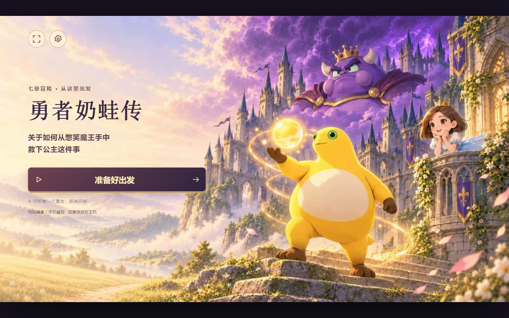
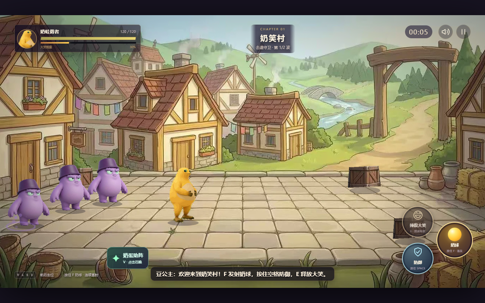
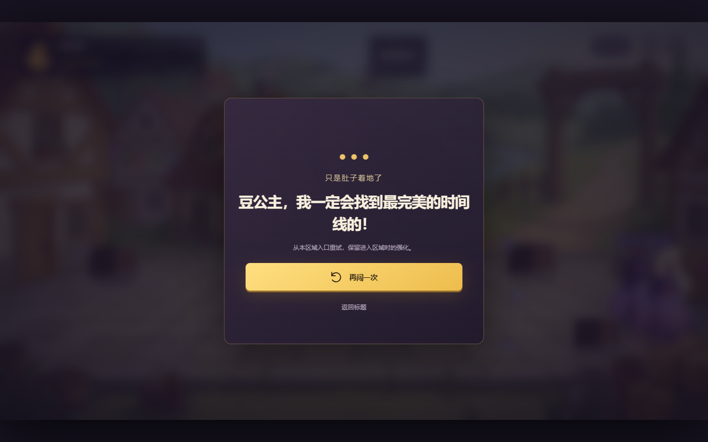

# 勇者奶蛙传 · 离线版

奶蛙勇闯憋笑城堡，肚皮冲撞、大笑清场，闯过七关救出豆公主。

### ▶ 在线玩：<https://eric-thy.github.io/naiwa/>

## 这是什么

原版是 metaapp / 233 乐园上的 H5 小游戏（Phaser 3 + Vite），活动结束后就玩不到了。
这里把它完整扒下来重新打包，做成**不依赖原站**的两个版本：

| | 说明 | 大小 |
| --- | --- | --- |
| **网页版**（本仓库根目录） | 图片/音频按需加载，首屏约 4 MB 即可开玩 | 29 MB |
| **单文件离线版** | 所有资源内嵌进一个 HTML，断网双击可玩 | 41 MB |

单文件离线版下载：**[naiwa-offline.html](https://github.com/eric-thy/naiwa/releases/download/v1.0.0/naiwa-offline.html)**
（或见 [Releases](../../releases) 页）

## 改动

原版死亡后必须「看完广告再闯一次」，而离线环境根本放不出广告，
点了只会提示「当前环境不支持广告，请在 233 乐园中打开」，等于卡死。

这一版把广告流程整段摘掉了：失败界面直接点「再闯一次」，
立刻从本区域入口重来，保留进入区域时的强化。其余玩法与原版一致。

## 操作

| 键 | 作用 |
| --- | --- |
| WASD / 方向键 | 走位 |
| F | 奶球（按住连发） |
| 空格 | 防御（按住） |
| Shift | 肚皮冲撞（通关奶笑村后解锁） |
| E | 捧腹大笑 |
| C | 黄桃罐头 |
| V | 奶蛋助阵 |
| Q | 讲笑话（最终关） |
| Esc | 暂停 |

手机：左侧滑出摇杆，右侧技能键。

## 截图

| 游戏内 | 失败界面（已去广告） |
| --- | --- |
|  |  |

## 技术说明

原站是 Vite 打包的 ES module 应用，`file://` 下浏览器会拦掉 ES module 和 `fetch`，
直接「另存为」是跑不起来的。做的事：

1. **重打包 JS**：用 esbuild 把 entry / main / phaser 三个 ES 模块合成一个经典脚本，
   并绕开 Vite 的动态 import 预加载（否则本地加载 CSS 失败会中断启动）。
2. **网页版**：只内联 JS 与 CSS，图片、音频、结局动画仍走正常 HTTP，
   由游戏自带的加载器按需拉取 —— 首屏从 41 MB 降到约 4 MB。
3. **单文件版**：把 82 个资源转成 data URI，再挂一个 `fetch` / `img` / `audio` / `video` 垫片，
   字节与线上完全一致，原版的 SHA-256 校验照样通过；
   20 MB 的结局动画单独放在 `<script type="text/plain">` 里，走到结局才解码。

## 版权

游戏素材与代码版权归原作者所有，本仓库仅为个人离线存档与学习用途，请勿商用。若原作者要求，可随时删除。

原始地址：<https://h5.metaapp.cn/online/h5/BUsvkkbBiAq2pF2Ttx4j/1.0.2/6/index.html>
